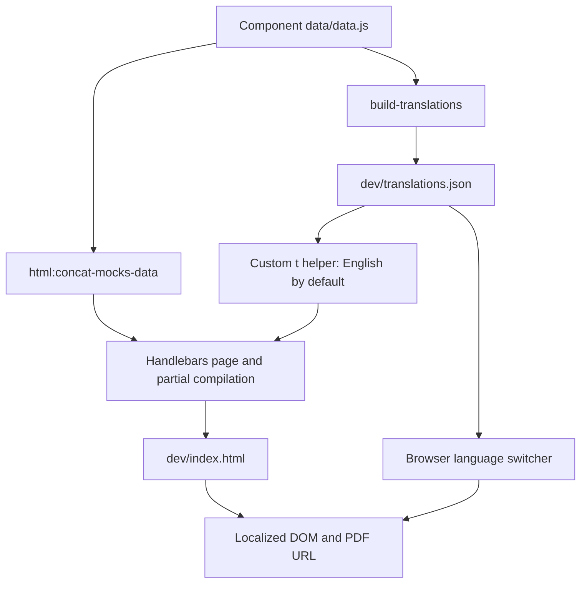

# Architecture

## Purpose and boundaries

The application is a static, single-page resume with English, Russian and Ukrainian content,
light/dark themes, contact links, PDF downloads and language-proficiency details.
The browser receives pre-rendered HTML, CSS, a small JavaScript bundle and a translation JSON file.
There is no server application, API, database, client router, authentication or runtime UI framework.
Node is required for authoring/building, not for serving the result.

TARS 1.15.1 is vendored and customized in this repository. Gulp 4 orchestrates tasks;
Handlebars produces HTML; Dart Sass and PostCSS/Autoprefixer produce CSS;
Babel, gulp-concat and Terser produce browser JavaScript. Phosphor supplies UI SVG icons at build time. The configured Webpack bundler
is only used if the JS workflow changes from `concat` to `modular`.

## Source map

| Path | Responsibility |
| --- | --- |
| `markup/pages/index.html` | Only current public page; composes partials and references assets |
| `markup/components/` | Resume sections, data and browser interactions |
| `markup/components/before-page-content/` | Inline JS detection, language visibility and theme pre-init |
| `markup/components/head/` | Metadata, favicon partial and stylesheet reference |
| `markup/static/scss/` | Styling entries, shared rules, theme tokens and component import registry |
| `markup/static/js/main.js` | Placeholder entry for inactive modular JS workflow |
| `markup/static/img/` | Content/general/plugin images and sprite inputs |
| `markup/static/fonts/` | Font assets supported by the builder; current typography uses system fonts |
| `markup/static/misc/` | Files copied to output root, including `media/` PDFs and favicons |
| `tars/tasks/`, `tars/watchers/` | Build implementation and watch orchestration |
| `tars/user-tasks/` | Custom tasks and Handlebars helpers |
| `tars-config.js`, `plugins-config.json` | Workflow choices, paths and plugin options |
| `dev/`, `builds/` | Regenerated staging/development and production output |

Components follow `components/<name>/<name>.html`, optional SCSS/JS, and `data/data.js`.
A folder may contain multiple scripts/partials. `_template/` and `_template.html` are scaffolds.
Non-underscore page templates are compiled into HTML; partials are registered from components.
`default_component_scheme.json` describes component scaffolding.

## Rendering and data flow

Data files declare a `data` variable and are evaluated by build code. They are trusted executable
source files. The standard mock-data pipeline supplies component objects and arrays to Handlebars;
the custom translation task independently extracts localized leaves into a language-first JSON tree.
HTML initially renders in English through `{{t}}` or explicit `.en` fields in loops.
`data-i18n` and `data-i18n-attr` provide keys for later DOM replacement.
See [localization](i18n-pattern.md) for exact schema and constraints.

The document head runs JS detection, language pre-init and theme selection before body rendering.
The body injects the SVG symbols token and includes the header, main content and footer, then references the
asynchronous concatenated JS bundle. `sections/sections.html` places languages, hard skills and
employment in the sidebar, with experience, achievements and soft skills in the main column.

## Build composition

`gulpfile.js` loads `tars/tars.js`, creating the shared global `tars`, then discovers and registers
system and user tasks. `tars/helpers/tars-fs-helper.js` merges discovered files by parent folder
and filename, allowing user overrides; helper directories, example tasks and underscore files
are excluded. The same mechanism discovers watchers.

`tars.require()` obtains most framework packages from TARS-CLI when its `npmRoot` environment
variable is supplied, otherwise from local resolution. Project tasks also use ordinary local
`require()`. Both the global CLI installation and local lockfile influence reproducibility.
`plugins-config.json` is parsed with comment support and configuration substitutions.

`main:build-dev` runs these stages:

1. Clean generated output; prepare SVG/raster inputs and sprites.
2. Compile SCSS, concatenate component mock data, and copy misc/font/image/separate assets.
3. Generate `dev/translations.json` from component data.
4. Process JavaScript and compile page templates.

`main:build` starts with that pipeline, then runs the Git-index public-repository check,
modifies HTML and optimizes images, copies staging files to `builds/` excluding `temp/`,
compresses CSS and runs `inline-source`. Archiving is configured off.
The stylesheet link has `inline`, so production HTML embeds CSS. JavaScript remains external.
The standalone `minify-html`, `webp-lossless` and FTP `deploy` user tasks are not called by
`main:build`; normal HTML minification is handled by `html:modify-html`.

Without min/release flags, `tars.isDevMode` is true even when invoking `build`.
`--min` selects `.min` CSS/JS references; `--release` additionally inserts a random build hash.
Build-directory versioning is disabled. Template tokens resolve static paths, the SVG sprite,
minified suffixes and hashes. They must remain in authored source.

`dev --lr` enables watchers and BrowserSync on port 3004, serving `dev/`.
`dev` alone enables watchers without BrowserSync. Component data edits regenerate translations,
rebuild mock data and recompile templates. Template edits regenerate translations and compile HTML.
Active CSS/concat JS sourcemaps are enabled by watch state, so a one-shot `build-dev` does not
have the same sourcemap behavior as a watch session.

## JavaScript and browser state

The concat task reads framework/library/plugin globs, configured before-component files,
component JS globs and configured after-component files. It excludes `data/data.js`,
underscore-prefixed JS and separate JS. It does not read `markup/static/js/main.js`.
Component scripts use IIFEs and DOM guards; there is no module import graph.
Babel runs before concatenation, and Terser minifies when min/release flags are present.
Console/debugger removal is enabled through plugin settings for that minification step.

| Script | Responsibility and state |
| --- | --- |
| `before-page-content/language-pre-init.html` | Reads `preferred-lang`; sets `data-pending-lang` or `data-lang-ready` |
| `header/language-switcher.js` | Fetches/caches translations, cycles en → ru → uk, updates text/attributes, root `lang`, preference and PDF URL |
| `before-page-content/theme-switcher.html` | Chooses stored theme or system preference; listens to system theme changes when no preference is stored |
| `header/reading-mode-toggle.js` | Toggles `data-theme`/`theme`, sets pressed state, temporarily uses light theme for print |
| `header/copy-email.js` | Copies the mailto address using Clipboard API and briefly updates feedback |
| `languages/languages.js` | Opens TOEFL details, closes on outside click/Escape and updates ARIA state |

Preferences are stored locally in the browser; there is no server-side language negotiation.
The PDFs under `markup/static/misc/media/` are separate maintained files. The build copies them;
it does not render PDF documents from the current resume HTML.

## Styles and assets

`entry/main.scss` imports normalize, libraries, generated service imports, plugins, registered
component styles and final extra rules. The service partial imports mixins, generated sprite
styles, fonts, `vars.scss`, GUI and `common.scss`. `common.scss` is shared styling imported
into the entry; it is not an independently compiled application entry.
Register new component imports in `entry/partials/_components.scss`.
Do not hand-edit generated sprite styles or the builder-managed service partial.

`vars.scss` defines light tokens on `:root`, dark overrides on `[data-theme="dark"]`,
SCSS typography values and reduced-motion transition behavior. The page uses system fonts.
At 768px the page becomes an inset scrolling panel; section layouts also change at larger widths.
Shared styles provide skip/focus affordances, `.only-js`, `.only-print` and `.no-print` behavior,
with print rules alongside component styles. Inspect print preview as well as screen layouts
when changing dimensions or positioning.

UI icons are regular-weight SVGs from the pinned `@phosphor-icons/core` dev dependency.
The custom `PhosphorIcon` Handlebars helper resolves the requested
package SVG, and inlines it with the caller's class and dimensions. Package `viewBox` and
`currentColor` are preserved; decorative icons have `aria-hidden="true"` and `focusable="false"`.
Links and buttons supply their accessible names. Names are validated as kebab-case and unknown
icons fail template compilation. Only referenced Phosphor SVGs are inlined; no Phosphor JavaScript or
full-library Phosphor sprite is shipped. Local TARS symbols are injected separately.

Templates use package names such as `envelope`, `github-logo`, `linkedin-logo`, `telegram-logo`,
`map-pin` and `file-pdf`. To add an icon, use its regular-weight package name with `{{PhosphorIcon}}`;
there is no selection list or copy task. The standard TARS SVG symbols workflow is also active. Local SVGs in
`markup/static/img/svg/` are optimized, assembled into a sprite and injected through
`%=symbols=%` in page templates. The built-in `Icon` helper uses generated `__iconsData`
metadata and renders `<use>` references. SVG watchers regenerate the sprite, metadata and HTML
when local source files change. No unused local SVGs are retained; add custom artwork only
when it is referenced through `Icon`. The header uses Phosphor through `PhosphorIcon`. The package license is retained under
`markup/static/misc/licenses/phosphor-icons.txt` and copied to the published site.

Image and misc copying are handled separately; a source in `misc/media/` is served as `media/`,
not `static/misc/media/`. Deployment publishes the complete `builds/` directory.
For operational dependencies and observed failure modes, see [operations](operations.md).
